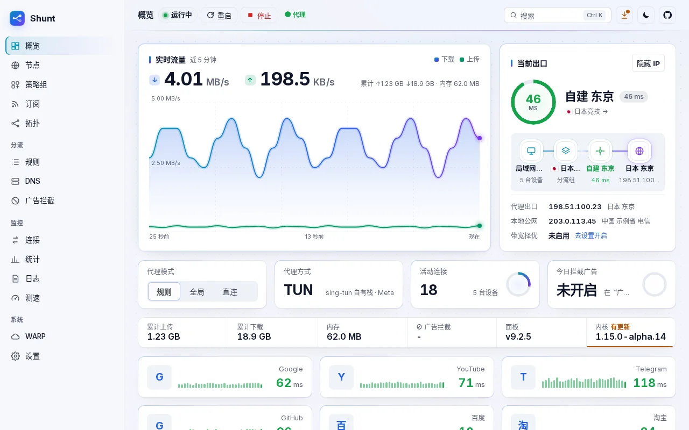
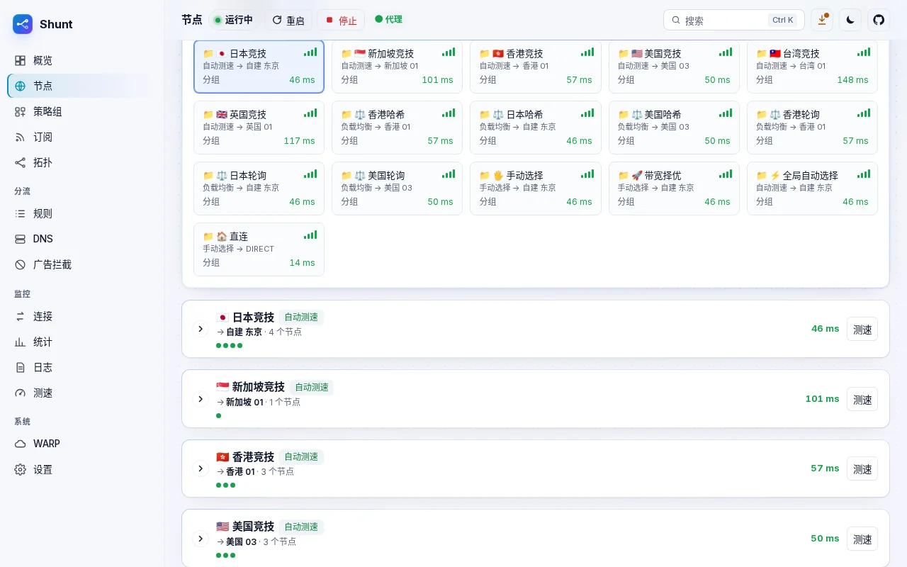
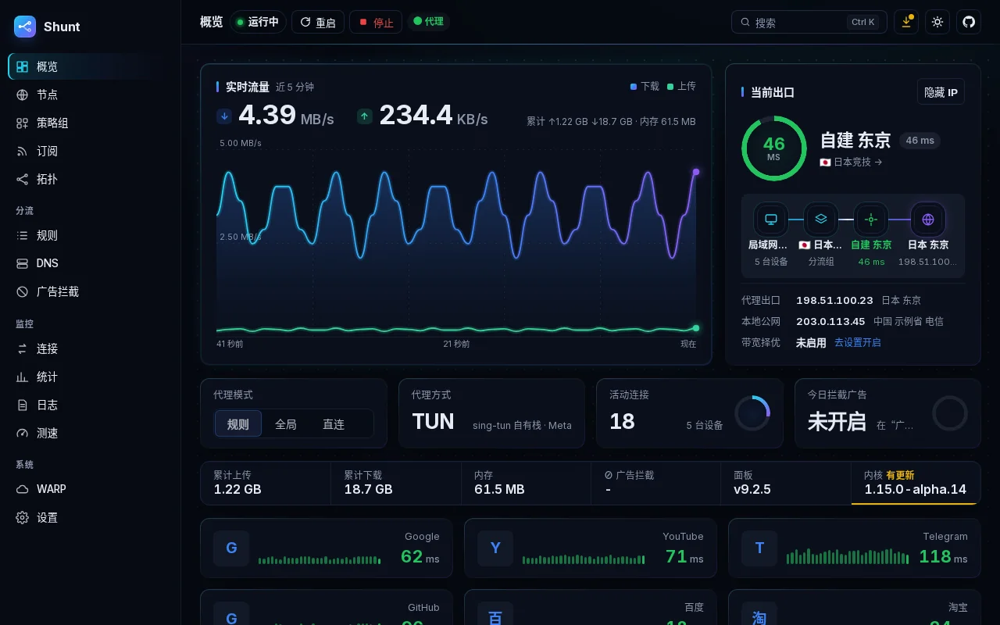
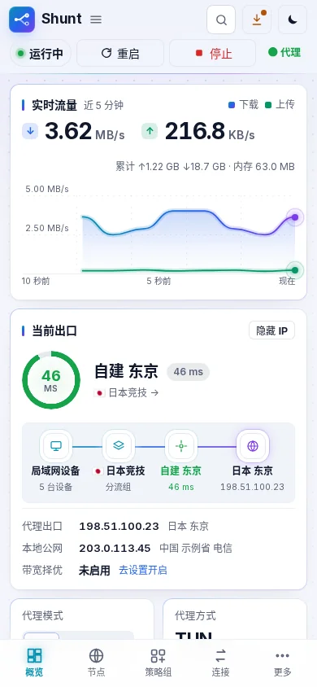

<p align="center"></p>

<h1 align="center">Shunt 分流</h1>

<p align="center">Alpine 旁路由一键透明代理 + Web 管理面板，支持 mihomo / mihomo Smart / sing-box（官方与 reF1nd / MiChongs 魔改版）内核</p>

<p align="center">📖 <b>详细使用说明（每个功能的入口和操作步骤）：<a href="https://skycnhe.github.io/Shunt-release/">skycnhe.github.io/Shunt-release</a></b></p>

Shunt 装在 **Alpine Linux 旁路由**（软路由、PVE / ESXi 虚拟机、LXC 容器、旧电脑、ARM 小板子都行）上。局域网设备把 **网关和 DNS** 指向旁路由即可分流：国内直连、国外走代理，手机、电视、游戏机不用逐台装客户端。订阅、节点、策略组、规则、DNS、内核和面板更新都在网页里完成。

> Shunt 只负责分流和管理，**不提供节点**。第一次用请准备好自己的订阅链接或节点链接。



## 版本

| 通道 | 版本 | 分支 | 说明 |
| --- | --- | --- | --- |
| 正式版 | **v9.2.5** | [`shunt`](https://github.com/Skycnhe/Shunt-release/tree/shunt)（默认） | 稳定版，有 Docker 镜像和离线包 |
| 预览版 | **v9.2.7** | [`shunt-preview`](https://github.com/Skycnhe/Shunt-release/tree/shunt-preview) | 最新改动，版本号形如 `9.2.7-preview.N+提交号`；无 Docker / 离线包 |

- 本页是 **`shunt`** 分支的说明，本分支的改动见 [CHANGELOG.md](CHANGELOG.md)。
- 两个通道在面板「设置 → 备份与更新 → 面板更新」里随时切换，订阅和设置保留。
- 预览版比正式版多：🩺 板子性能体检、AES 加密提示、🧪 TUN 协议栈对比（手动）、📱 设备实时流量、🔁 故障切换记录（只保留最新 5 条）、配置快照「↩ 回到上一份」、sing-box TUN 多队列 multi_queue、mihomo TUN「默认」改用 system。
- 另有只用 sing-box 的 [`shunt-singbox`](https://github.com/Skycnhe/Shunt-release/tree/shunt-singbox) / [`shunt-singbox-preview`](https://github.com/Skycnhe/Shunt-release/tree/shunt-singbox-preview) 分支，说明见各自分支。

## 安装

在旁路由上用 root 执行；重复执行就是覆盖升级，订阅和设置保留。

**正式版**

```sh
# 国内网络
wget -qO- https://ghfast.top/https://raw.githubusercontent.com/Skycnhe/Shunt-release/shunt/install.sh | sh -s -- --cn

# 国外网络
wget -qO- https://raw.githubusercontent.com/Skycnhe/Shunt-release/shunt/install.sh | sh
```

**预览版**（装完更新通道自动设为预览版）

```sh
# 国内网络
wget -qO- https://ghfast.top/https://raw.githubusercontent.com/Skycnhe/Shunt-release/shunt-preview/install.sh | PANEL_BRANCH=shunt-preview sh -s -- --cn

# 国外网络
wget -qO- https://raw.githubusercontent.com/Skycnhe/Shunt-release/shunt-preview/install.sh | PANEL_BRANCH=shunt-preview sh
```

装完打开 `http://旁路由IP:8080`（默认无密码、只允许局域网访问）。

**离线包**（aarch64 / x86_64，Alpine 3.22 / 3.23 / 3.24，只跟正式版）：从 [Releases · offline](https://github.com/Skycnhe/Shunt-release/releases/tag/offline) 下载对应包，传到设备后：

```sh
tar xzf shunt-offline-*.tar.gz && sh shunt-offline/install.sh
```

**Docker**（Linux 宿主机 + host 网络，amd64 / arm64，只有正式版）：

```sh
docker run -d --name shunt --restart unless-stopped --network host \
  --cap-add NET_ADMIN --cap-add NET_RAW --device /dev/net/tun \
  -v shunt-data:/data -e TZ=Asia/Shanghai --stop-timeout 30 \
  skycn2022/shunt:latest
```

**32 位 ARM（armv7）**：只能一键安装（没有离线包和 Docker），sing-box 魔改版只能用 MiChongs。

安装参数、Debian / Ubuntu（实验性）、Docker 宿主机准备、面板密码与端口、卸载等见 [详细使用说明 · 安装与更新](https://skycnhe.github.io/Shunt-release/#install)。

## 功能概览

- **透明代理**：TProxy（默认）/ TUN / 关闭，Fake-IP、IPv6、直连不进内核（入口旁路）、绕过设备、看门狗故障自动直连
- **多内核**：mihomo、mihomo Smart、sing-box 官方稳定版 / 预览版、魔改版 reF1nd 正式版 / 预览版、MiChongs，一键切换、校验失败自动切回，内核在线更新与回滚
- **订阅**：Clash / Base64 订阅、Xboard / V2Board 面板登录、手动导入节点；「每天更新订阅」与「订阅自动更新」合并为同一任务（30 分钟内已更新的跳过、忙时推迟、失败 10 分钟后重试最多 3 次）
- **节点与分组**：按地区自动生成竞技 / 哈希 / 轮询组，自定义策略组（含主备故障转移）、带宽择优、WARP、链式代理（SOCKS5 / HTTP / HTTPS）
- **订阅分享**：选节点生成 `/share/<令牌>` 链接，base64 或 Clash 配置，二维码本地生成
- **规则 / 广告拦截 / DNS**：自定义规则、规则集订阅（切换不断连）、AdGuard / hosts 列表、DNS 泄露检测与防绕过
- **监控**：测速（国内直连 / 国外经代理）、连接、统计（保留 60 天）、日志、拓扑、流媒体 / AI 解锁检测、网络诊断
- **维护**：面板在线更新（正式 / 预览通道）、配置快照、备份 / 恢复、版本备份一键回滚、Telegram 通知、多语言与主题

每个页面、每个按钮怎么用：👉 **[skycnhe.github.io/Shunt-release](https://skycnhe.github.io/Shunt-release/)**

## 截图

| 节点 | 深色主题 |
| --- | --- |
|  |  |

<p align="center"></p>

## 许可证

GPL-3.0-or-later，全文见 [LICENSE](LICENSE)。
