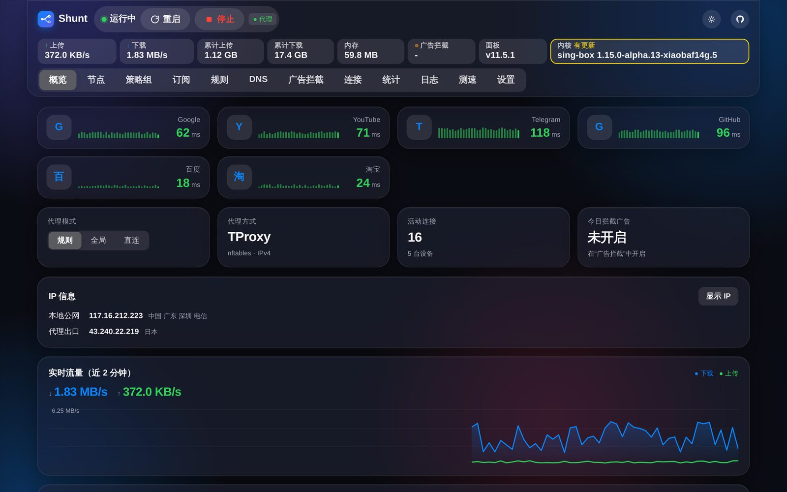
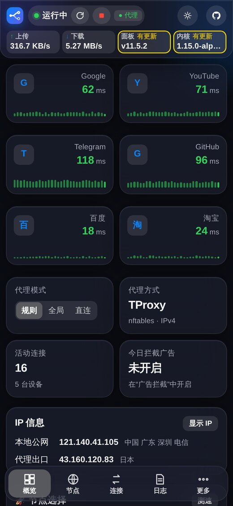

<p align="center"></p>

<h1 align="center">Shunt 分流 · shunt-singbox</h1>

## 截图



| 节点 | 策略组 |
| --- | --- |
|  |  |
| **主题** | **手机** |
|  |  |

## 一键安装

在 Alpine Linux 上用 root 执行，装完打开 `http://旁路由IP:8080`：

```sh
# 国内网络
wget -qO- https://ghfast.top/https://raw.githubusercontent.com/Skycnhe/Shunt-release/shunt-singbox/install.sh | sh -s -- --cn

# 国外网络
wget -qO- https://raw.githubusercontent.com/Skycnhe/Shunt-release/shunt-singbox/install.sh | sh
```
