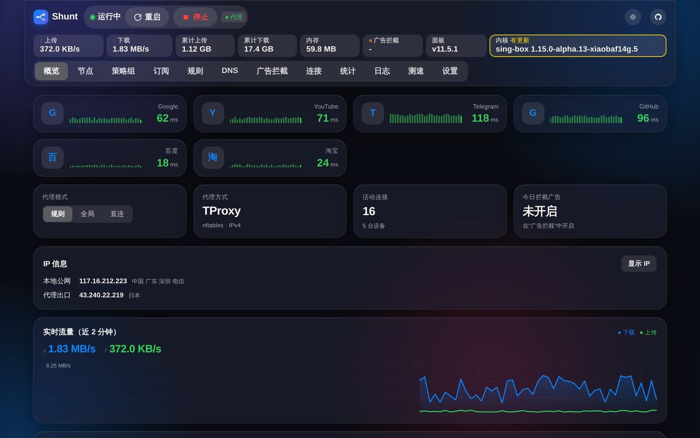
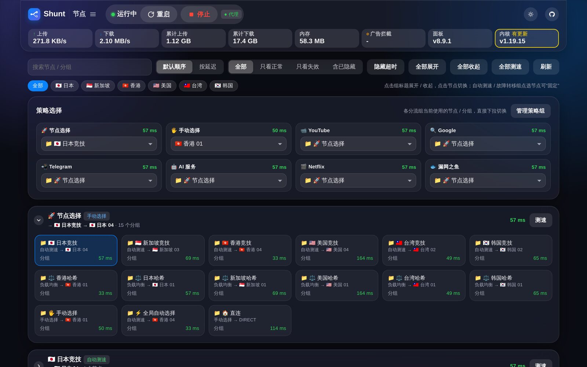
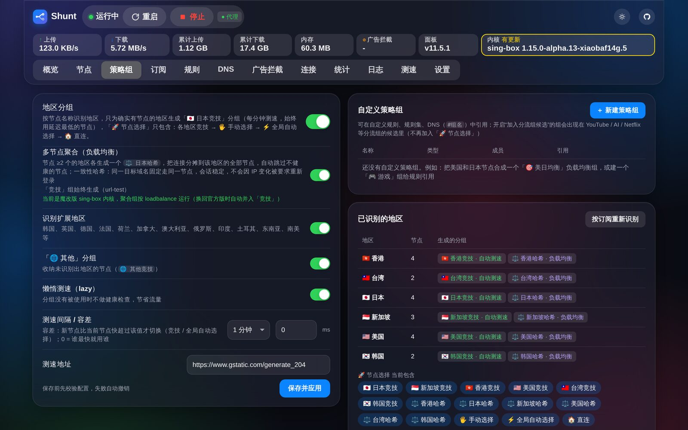
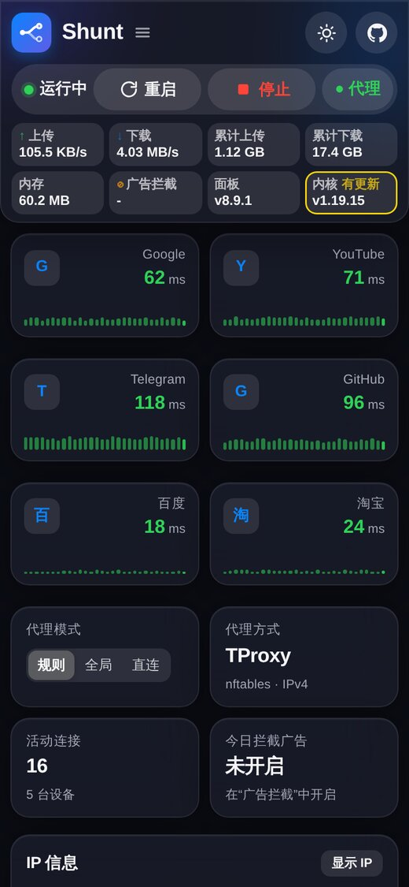

<p align="center"></p>

<h1 align="center">Shunt 分流 · shunt-singbox</h1>

<p align="center">🌐 在线说明（mihomo 版写的，大部分页面通用）：<a href="https://skycnhe.github.io/Shunt-release/">skycnhe.github.io/Shunt-release</a></p>

Shunt 是装在 **Alpine Linux 旁路由**（软路由、PVE / ESXi 虚拟机、LXC 容器、旧电脑都行）上的一键透明代理 + Web 管理面板，内核用 sing-box。局域网设备把 **网关和 DNS** 指向旁路由即可分流：国内直连、国外走代理，手机、电视、游戏机不用逐台装客户端。所有日常操作（订阅、节点、策略组、规则、广告拦截、DNS、代理方式、内核更新、面板更新）都在网页里完成。

> Shunt 只负责分流和管理，**不提供节点**。第一次用请准备好自己的订阅链接或节点链接。

> 本分支从 v11.7.8 起面板后端改为 **Go 单个程序**（`/opt/mihomo-panel/shunt`），设备上不再需要 python3，页面和功能与 Python 版一致。

## 目录

- [分支说明](#分支说明)
- [截图](#截图)
- [工作原理与端口](#工作原理与端口)
- [系统要求](#系统要求)
- [一键安装](#一键安装)
- [离线安装](#离线安装)
- [Docker 安装](#docker-安装)
- [首次进入面板](#首次进入面板)
- [日常使用](#日常使用)
- [内核](#内核)
- [在线更新与预览通道](#在线更新与预览通道)
- [从 Python 版升级到 Go 版](#从-python-版升级到-go-版)
- [备份与回滚](#备份与回滚)
- [常见问题与排错](#常见问题与排错)
- [卸载](#卸载)
- [许可证](#许可证)

## 分支说明

发布仓库 [Skycnhe/Shunt-release](https://github.com/Skycnhe/Shunt-release) 只放安装 / 更新用的发布文件，有四个分支：

| 分支 | 通道 | 内核 | 面板后端 | 设备需要 python3 | CPU 架构 | Docker / 离线包 |
| --- | --- | --- | --- | --- | --- | --- |
| [`shunt`](https://github.com/Skycnhe/Shunt-release/tree/shunt)（默认） | 正式 | mihomo / mihomo Smart / sing-box，面板里一键切换 | Python | 需要（安装脚本自动装） | amd64 / arm64 / armv7 | 有 / 有 |
| [`shunt-preview`](https://github.com/Skycnhe/Shunt-release/tree/shunt-preview) | 预览 | 同 `shunt` | Python | 需要 | amd64 / arm64 / armv7 | 无（只跟正式版） |
| [`shunt-singbox`](https://github.com/Skycnhe/Shunt-release/tree/shunt-singbox) | 正式 | 只有 sing-box（官方版或 reF1nd / MiChongs 魔改版） | **Go 单个程序** | **不需要** | amd64 / arm64 / armv7 / 386 | Docker 有（`:singbox`）/ 离线包暂未发布 |
| [`shunt-singbox-preview`](https://github.com/Skycnhe/Shunt-release/tree/shunt-singbox-preview) | 预览 | 同 `shunt-singbox` | **Go 单个程序** | **不需要** | amd64 / arm64 / armv7 / 386 | 无（只跟正式版） |

- **正式 / 预览**：正式版是测试过的稳定版本；预览版是最新改动，版本号形如 `9.1.11-preview`、`11.7.8-preview.792+c7b71f9`。两者可以在面板里随时切换（见 [在线更新与预览通道](#在线更新与预览通道)），不用重装。
- **mihomo 分支 / sing-box 分支**：`shunt` 系列以 mihomo 为主，面板里还能切到 mihomo Smart 或 sing-box；`shunt-singbox` 系列只用 sing-box。两个系列的面板页面基本相同，订阅、规则等数据格式通用。
- **Go 版**：`shunt-singbox-preview` 的面板后端是 Go 写的单个程序，不再依赖 python3；安装和在线更新时按分支里的 `bin/SHA256SUMS` 下载本机架构的程序，并做 sha256 校验。
- 本页是 **`shunt-singbox`** 分支的说明，当前版本见 [CHANGELOG.md](CHANGELOG.md)。

## 截图



| 节点 | 策略组 |
| --- | --- |
|  |  |
| **主题** | **手机** |
|  |  |

## 工作原理与端口

局域网设备的网关指向旁路由后，流量由 nftables 打标记转给内核（TProxy），或由内核的 TUN 网卡接管；设备发往 53 端口的 DNS 查询被劫持到内核的 1053 端口。内核按规则决定直连还是走哪个节点。面板负责生成配置、启停内核、测速、看门狗、日志和统计。

| 组件 | 端口 / 路径 | 说明 |
| --- | --- | --- |
| 面板网页 | `8080` | 服务名 `shunt`，改端口见 [首次进入面板](#首次进入面板) |
| HTTP / SOCKS5 混合代理 | `7890` | 不想走透明代理的设备，可以把代理手动设到 `旁路由IP:7890` |
| TProxy 入口 | `7893` | `tproxy.sh` 把局域网流量转到这里 |
| 内核 DNS | `1053` | 局域网设备的 53 端口 DNS 被重定向到这里 |
| 内核控制接口 | `127.0.0.1:9090` | 只监听本机，面板与内核通信用 |
| 代理内核服务 | 服务名 `shunt-core` | 程序在 `/usr/local/bin/`（`sing-box`） |
| 面板程序 | `/opt/mihomo-panel/shunt` | Go 单个程序，另有 `index.html`、`tproxy.sh`、`init.d` 等 |
| 面板数据 | `/etc/mihomo-panel/data.json` | 订阅、节点、规则、设置都在这里 |
| 内核配置（自动生成） | `/etc/sing-box/config.json`，规则集在 `/etc/sing-box/rules/` | 由面板生成，不要手改 |
| 日志 | `/var/log/mihomo-panel.log`（面板）、`/var/log/mihomo.log`（内核） | 内核上次运行的末尾保存在 `/var/log/mihomo.log.prev` |

Fake-IP 模式下设备拿到的是 `198.18.x.x` / `198.19.x.x` 这样的虚拟地址，这是正常的。请确保旁路由上没有别的程序占用 8080 / 7890 / 7893 / 1053 / 9090。

## 系统要求

- **Alpine Linux**（OpenRC；离线包按 3.22 / 3.23 / 3.24 打包）；用 **root** 执行安装。其他发行版不支持（安装脚本会直接退出）。
- CPU 架构：**amd64（x86_64）/ arm64（aarch64）/ armv7 / 386（i686）**。
- 内核模块：TProxy 需要 `nft_tproxy`，TUN 需要 `tun`（`/dev/net/tun`）。安装脚本会尝试加载并写入 `/etc/modules`；两者都不可用时只能用 7890 端口手动代理。
- 依赖由安装脚本用 apk 自动安装：curl、wget、nftables、iptables、iproute2、gzip、tar、tzdata 等。**不需要 python3**。
- 旁路由要有固定的局域网 IP。
- **PVE LXC 容器**：容器里没有自己的内核，模块和 TUN 设备要在宿主机准备。安装脚本检测到 LXC 时会打印需要在宿主机执行的命令（`modprobe nft_tproxy`、在 `/etc/pve/lxc/<ID>.conf` 加 `lxc.cgroup2.devices.allow: c 10:200 rwm` 与 `lxc.mount.entry: /dev/net/tun dev/net/tun none bind,create=file`，并在 选项 → 功能 勾选 nesting）。

## 一键安装

在旁路由上用 root 执行（本分支 `shunt-singbox`）：

```sh
# 国内网络（apk 换中科大镜像，GitHub 下载走 ghfast.top，失败自动换 gh-proxy.com）
wget -qO- https://ghfast.top/https://raw.githubusercontent.com/Skycnhe/Shunt-release/shunt-singbox/install.sh | sh -s -- --cn

# 国外网络
wget -qO- https://raw.githubusercontent.com/Skycnhe/Shunt-release/shunt-singbox/install.sh | sh
```

装完会打印面板地址，例如 `http://192.168.1.2:8080`。重复执行同一条命令就是**覆盖升级**，订阅和设置都会保留。

<details><summary>四个分支的安装命令</summary>

**`shunt`**（mihomo 正式版）

```sh
# 国内网络（apk 换中科大镜像，GitHub 下载走 ghfast.top）
wget -qO- https://ghfast.top/https://raw.githubusercontent.com/Skycnhe/Shunt-release/shunt/install.sh | sh -s -- --cn

# 国外网络
wget -qO- https://raw.githubusercontent.com/Skycnhe/Shunt-release/shunt/install.sh | sh
```

**`shunt-singbox`**（sing-box 正式版（Go））

```sh
# 国内网络（apk 换中科大镜像，GitHub 下载走 ghfast.top，失败自动换 gh-proxy.com）
wget -qO- https://ghfast.top/https://raw.githubusercontent.com/Skycnhe/Shunt-release/shunt-singbox/install.sh | sh -s -- --cn

# 国外网络
wget -qO- https://raw.githubusercontent.com/Skycnhe/Shunt-release/shunt-singbox/install.sh | sh
```

**`shunt-preview`**（mihomo 预览版）

```sh
# 国内网络（apk 换中科大镜像，GitHub 下载走 ghfast.top）
wget -qO- https://ghfast.top/https://raw.githubusercontent.com/Skycnhe/Shunt-release/shunt-preview/install.sh | PANEL_BRANCH=shunt-preview sh -s -- --cn

# 国外网络
wget -qO- https://raw.githubusercontent.com/Skycnhe/Shunt-release/shunt-preview/install.sh | PANEL_BRANCH=shunt-preview sh
```

**`shunt-singbox-preview`**（sing-box Go 预览版）

```sh
# 国内网络（apk 换中科大镜像，GitHub 下载走 ghfast.top，失败自动换 gh-proxy.com）
wget -qO- https://ghfast.top/https://raw.githubusercontent.com/Skycnhe/Shunt-release/shunt-singbox-preview/install.sh | PANEL_BRANCH=shunt-singbox-preview sh -s -- --cn

# 国外网络
wget -qO- https://raw.githubusercontent.com/Skycnhe/Shunt-release/shunt-singbox-preview/install.sh | PANEL_BRANCH=shunt-singbox-preview sh
```

</details>

**安装参数**（放在 `sh -s --` 后面，可组合）：

| 参数 / 环境变量 | 作用 |
| --- | --- |
| `--cn` | 国内网络：apk 源换成 `mirrors.ustc.edu.cn`，GitHub 下载走 `https://ghfast.top/`，失败自动换内置的 `https://gh-proxy.com/` |
| `--update-core` | 重新下载最新的 sing-box 内核（默认已装过就不重下） |
| `--https` | 生成自签名证书，面板改用 `https://`（之后也能在设置里开关） |
| `--selftest` | 安装后用真实内核校验多种配置场景 |
| `GH_PROXY=https://gh-proxy.com/` | 指定 GitHub 加速地址（覆盖 `--cn` 的默认值） |
| `APK_MIRROR=mirrors.aliyun.com` | `--cn` 时改用别的 apk 镜像 |
| `PANEL_BRANCH=<分支>` | 指定从发布仓库的哪个分支安装 |

环境变量要写在管道右边的 `sh` 前面，例如：

```sh
wget -qO- https://ghfast.top/https://raw.githubusercontent.com/Skycnhe/Shunt-release/shunt-singbox/install.sh | GH_PROXY=https://gh-proxy.com/ sh -s -- --cn
```

如果 `ghfast.top` 也打不开 raw 地址，把命令里的 `https://ghfast.top/` 换成 `https://gh-proxy.com/` 再试。

## 离线安装

`shunt-singbox` 系列的离线包**暂未发布**（`offline.sh` 指向的 Releases 标签 `offline-HK003` 目前不存在，执行会下载失败），请用一键安装或 Docker。

完全不联网的设备可以改用 mihomo 系列 `shunt` 分支的离线包（[Releases · offline](https://github.com/Skycnhe/Shunt-release/releases/tag/offline)，包里也带 sing-box 内核，装好后可在面板里切到 sing-box），那是 `shunt` 分支的面板。

## Docker 安装

只支持 **Linux 宿主机 + host 网络**（透明代理规则写在宿主机网络里）；镜像有 amd64 / arm64 两种架构，只发布正式版。Docker Desktop（Windows / macOS）或 bridge 网络下透明代理不可用，只能用 7890 端口手动代理。

```sh
docker run -d --name shunt --restart unless-stopped --network host \
  --cap-add NET_ADMIN --cap-add NET_RAW --device /dev/net/tun \
  -v shunt-data:/data -e TZ=Asia/Shanghai --stop-timeout 30 \
  skycn2022/shunt:singbox
```

镜像只含 sing-box 内核，与 `shunt` 分支同一仓库，标签 `singbox`；固定版本用 `singbox-v<面板版本>`（如 `singbox-v11.7.1`）。也可以用 `ghcr.io/skycnhe/shunt-release:singbox`。

宿主机准备（容器和宿主机共用内核）：

```sh
modprobe nft_tproxy; modprobe tun
sysctl -w net.ipv4.ip_forward=1
```

- 数据全部在卷 `shunt-data:/data`，升级镜像不会丢配置。
- 8080 被占用时加 `-e PANEL_PORT=8081`（host 网络下 `-p` 端口映射不起作用）。
- Docker 会把宿主机 FORWARD 默认策略改成 DROP，局域网转发会被丢，需要放行，例如 `iptables -I DOCKER-USER -i eth0 -j ACCEPT`（`eth0` 换成连局域网的网卡）。
- 老内核（群晖等）TProxy 不可用时，在面板里把代理方式改成 TUN。

## 首次进入面板

1. 浏览器打开 `http://旁路由IP:8080`（安装结束时打印的地址；用了 `--https` 则是 `https://`，自签名证书提示不安全时选继续访问）。
2. **默认没有密码**，局域网内能打开地址的设备都能管理。
3. **默认只允许局域网访问**：来源必须是私有地址、本机、链路本地或 `100.64.0.0/10`（Tailscale / CGNAT）；地址栏必须是 IP、`localhost` 或 `.lan` / `.local` / `.home` / `.home.arpa` / `.internal` / `.ts.net` 等局域网域名，其他域名会显示「访问被拒绝」。

**修改面板端口**：

```sh
echo 'PANEL_PORT=8081' > /etc/conf.d/shunt
rc-service shunt restart
```

**设置面板密码**（建议在允许外网或用域名访问前设置）：

```sh
/opt/mihomo-panel/shunt --password 新密码   # 设置
/opt/mihomo-panel/shunt --password          # 查看是否已设置
/opt/mihomo-panel/shunt --password off      # 关闭（忘记密码时用）
```

> 面板页面里提示的 `shunt --password off` 就是这个程序；安装脚本没有把它放进 PATH，请写完整路径 `/opt/mihomo-panel/shunt`。

也可以在「设置 → 通知与安全 → 面板安全」里设置。设置后打开面板要先登录（会话 30 天）；脚本调用接口时加请求头 `X-Shunt-Auth: 密码`。

**从外网或用域名访问**（DDNS、反向代理、内网穿透）：

```sh
/opt/mihomo-panel/shunt --allow-host nas.example.com    # 允许用这个域名访问（--allow-host -nas.example.com 删除）
/opt/mihomo-panel/shunt --allow-public on                 # 允许非局域网来源访问（off 恢复只允许局域网）
```

允许外网前请务必先设置密码，并且不要把面板端口直接暴露到公网。

## 日常使用

### 1. 让设备走旁路由

把设备（或主路由 DHCP 下发）的 **网关** 和 **DNS** 都改成旁路由 IP。不要在设备上手动写 8.8.8.8 之类的 DNS，否则 DNS 绕过旁路由，按域名分流会失效。只想让个别设备不走代理：在「设置 → 网络 → 绕过设备」填 IP、网段或 MAC（MAC 只在 TProxy 下有效），并把这些设备的 DNS 设为主路由。

### 2. 订阅与节点

- 「订阅」页添加订阅：支持 Clash / Mihomo YAML 或 Base64 节点链接；默认排除「剩余流量 / 到期时间 / 官网」这类信息节点。列表显示节点数、流量、到期和更新时间。
- 订阅自动更新间隔在「设置 → 网络 → 订阅与分组」里选（1 小时到 3 天，默认 24 小时），也可以在「定时任务」里设每天固定时间更新。
- 「手动导入单个节点」：每行一个 `vless://` `vmess://` `ss://` `trojan://` `hysteria2://`（`hy2://`）`tuic://` 链接。
- 「节点」页可测速、按延迟排序、按地区筛选、隐藏超时节点；不想要的订阅节点可以「从订阅删除」，订阅更新后也不会再出现。

### 3. 策略组

面板按节点名称识别地区，自动生成：

- **竞技组**「🇯🇵 日本竞技」：定时测速，始终用延迟最低的节点；
- **哈希组**「⚖️ 日本哈希」（节点 ≥ 2 的地区）：一致性哈希，同一主域名固定走同一节点；
- **轮询组**「⚖️ 日本轮询」（节点 ≥ 2 的地区）：每条新连接换下一个节点，多线程下载可叠加带宽。登录类网站、银行、支付、游戏不要用；
- 「🌐 其他竞技」收纳没识别出地区的节点；「🚀 节点选择」包含各地区竞技 → 负载均衡 → 🖐️ 手动选择 → ⚡ 全局自动选择 → 🏠 直连。
- 官方 sing-box 内核不支持负载均衡，哈希 / 轮询组并入同地区竞技组；在「设置 → 核心 → 内核」里换成魔改版（reF1nd / MiChongs）即可多节点聚合。
- YouTube、Google、Telegram、AI、Netflix、漏网之鱼等分流组可以各自选节点；测速间隔、容差、懒惰测速、测速地址在「策略组」页设置。
- 「＋ 新建策略组」支持手动选择、自动测速、故障转移、负载均衡、一致性哈希、轮询；可按正则筛选节点，可设为「加入分流组候选」。

### 4. 规则

- 「规则」页：**规则测试**（输入域名查它命中哪条规则、走哪个组）；**自定义规则**优先于内置规则，支持 DOMAIN-SUFFIX / DOMAIN / DOMAIN-KEYWORD / GEOSITE / IP-CIDR / GEOIP / SRC-IP-CIDR / DST-PORT / PROCESS-NAME，可批量编辑；
- **规则集订阅**（rule-providers）：快速添加广告拦截、OpenAI、Apple / 微软直连、Steam 等，或填自己的地址；
- 「当前生效规则」列出最终配置里的全部规则。

### 5. 广告拦截

- 订阅 AdGuard / ABP、hosts、纯域名、Clash 规则格式的过滤列表，排在所有规则之前拒绝连接；可设自动更新（6 小时到每周）。
- 自定义黑名单（全部 / 只拦国内直连 / 只拦国外代理）和白名单（`@@||example.com^`，总是优先放行）。
- 「DNS 层拦截」：命中列表的域名直接返回 NXDOMAIN；「检测域名」查某个域名是否被拦；「今日拦截排行」保留 14 天。

### 6. DNS

- 增强模式 **fake-ip**（推荐，防泄露）或 **redir-host**；「国内域名走直连 DNS」：`geosite:cn,private` 用直连 DNS，其余全部走代理 DNS。
- respect-rules、阻止客户端绕过 DNS（拒绝 853 端口 DoT / DoQ 和常见公共 DoH）、Hosts 静态解析、DNS 分流策略（nameserver-policy，上游可加 `#策略组`）。
- 「DNS 泄露检测」检查配置并在线测试实际使用的上游，可一键应用防泄露设置；「DNS 查询」可直接查解析结果、清空缓存。

### 7. 代理方式：TProxy / TUN / 关闭

在「设置 → 网络 → 代理方式」切换：

- **TProxy**（默认）：nftables 把 TCP / UDP 转到 7893，DNS 劫持到 1053，性能最好；需要内核有 `nft_tproxy`。
- **TUN**：内核创建虚拟网卡接管流量，可选协议栈（system / gvisor / mixed）、auto-redirect、strict-route 等；TProxy 不可用（老内核、群晖、部分 LXC）时用它。
- **关闭**：不做透明代理，只能用 `7890` 手动代理。
- 「IPv6 透明代理」：内核与 DNS 启用 IPv6 并代理 IPv6 流量，需要客户端以旁路由作为 IPv6 网关。
- **看门狗**：每 30 秒检查内核，无响应自动重启；连续 2 次失败则关闭透明代理让局域网直连，内核恢复后自动重新接管。在「设置 → 网络 → 代理方式」卡片里开关。

### 8. 其他功能

连接（实时连接列表）、统计（每日流量、按设备 / 节点明细，保留 60 天）、日志、拓扑（负载均衡组实时连线）、落地（SOCKS5 落地出口，可指定前置节点）、测速（国内直连 / 国外经代理）、流媒体 / AI 解锁检测、网络诊断（一键体检）、系统优化（可一键恢复）、Telegram 通知、定时任务、主题与背景图。sing-box 分支另有「设置 → 网络 → 按设备分流」。

## 内核

「设置 → 核心 → 内核」可选：sing-box **官方稳定版 / 官方预览版**、**魔改版 reF1nd 正式版 / 预览版**、**魔改版 MiChongs 预览版**（魔改版支持多节点负载均衡）。
- 更新正在使用的内核时，新程序先校验能否运行、能否读取当前配置，通过才替换并重启，30 秒内没响应自动换回旧版本；也可以一键回滚。
- 内核下载使用「备份与更新 → 面板更新」里填的 GitHub 加速地址。查版本要用 GitHub API，机场出口常被限流（HTTP 403 rate limit），可填一个不勾任何权限的 GitHub Token 提高到每小时 5000 次。
- 命令行重装最新内核：重新执行一键安装命令并加 `--update-core`。

## 在线更新与预览通道

「设置 → 备份与更新 → 面板更新」：

- **检查更新 / 立即更新**：从发布仓库的 `shunt-singbox` 分支下载新文件，先经代理下载、失败再直连；国内可填「GitHub 加速」（如 `https://ghfast.top/`）。更新前自动校验并备份当前版本，新版启动失败会自动回滚。
- **更新通道**：选「预览版」后从同仓库的 `shunt-singbox-preview` 分支更新；切回「正式版」后点「立即更新」即装回正式版。
- **回滚上一版本**：一键回到更新前的版本。
- 命令行更新：重新执行一键安装命令即可（覆盖安装，数据保留）。

## 从 Python 版升级到 Go 版

Go 版（`shunt-singbox` v11.7.8 起）的面板是单个程序，页面、数据和功能与 Python 版一致，设备上不再需要 python3。升级不用卸载、配置全部保留：

**方法一：面板在线更新（推荐）**：「设置 → 备份与更新 → 面板更新」点「检查更新 → 立即更新」。旧版会先下载引导用的 `server.py` 和 `bin/SHA256SUMS`，重启时由引导程序按本机架构下载 Go 程序（sha256 校验）后交给它运行，只这一次用到 python3。

**方法二：重新执行一键安装命令**（覆盖安装）：

```sh
# 国内网络（apk 换中科大镜像，GitHub 下载走 ghfast.top，失败自动换 gh-proxy.com）
wget -qO- https://ghfast.top/https://raw.githubusercontent.com/Skycnhe/Shunt-release/shunt-singbox/install.sh | sh -s -- --cn

# 国外网络
wget -qO- https://raw.githubusercontent.com/Skycnhe/Shunt-release/shunt-singbox/install.sh | sh
```

**确认已是 Go 版**：

```sh
/opt/mihomo-panel/shunt --version     # 打印版本号即为 Go 版
rc-service shunt status
tail -n 50 /var/log/mihomo-panel.log
```

**说明**：

- `/etc/init.d/shunt` 在 `/opt/mihomo-panel/shunt` 存在时运行 Go 程序，否则仍用 python3 运行 `server.py`（引导程序），所以中途失败也不会让面板起不来。
- 在线更新失败（常见于国内 raw 被污染）：填好 GitHub 加速后重试，或直接用方法二。引导程序会按「GitHub 加速 → 本机代理 7890 → 内置镜像 → 直连」依次尝试。
- 想退回 Python 版：在「版本备份」里恢复更新前自动备份的版本（恢复 Python 版需要 python3 仍在）。
- Go 版的命令行选项：`/opt/mihomo-panel/shunt --help`。

## 备份与回滚

「设置 → 备份与更新」里有三种：

| 功能 | 内容 | 用法 |
| --- | --- | --- |
| 配置快照 | 每次修改设置前自动保存上一版设置，最近 10 份（不含密码） | 改错了点「恢复」，当前设置会先存为新快照 |
| 备份 / 恢复 | 订阅链接、手动节点、广告拦截、DNS 设置、Telegram Token 等全部设置 | 「下载备份」存到电脑；换机或重装后「从文件恢复」。备份含订阅链接，请妥善保管 |
| 版本备份 | 面板程序文件，在线更新前自动备份（带版本号），最近 10 个 | 「恢复」回到某个面板版本；或用「回滚上一版本」 |

命令行手动备份（全部设置都在 `/etc/mihomo-panel`）：

```sh
tar czf /root/shunt-backup-$(date +%F).tar.gz /etc/mihomo-panel
```

内核更新时旧程序保留为 `/usr/local/bin/<内核>.bak`，可在内核列表里「回滚」。

## 常见问题与排错

**先看日志、重启服务**：

```sh
tail -n 100 /var/log/mihomo-panel.log   # 面板日志（反馈问题时请附上）
tail -n 100 /var/log/mihomo.log         # 内核日志
rc-service shunt restart                 # 重启面板
rc-service shunt-core restart            # 重启代理内核
rc-service shunt status; rc-service shunt-core status
```

面板「设置 → 网络 → 网络诊断」可一键检查内核、透明代理 / TUN、IP 转发、DNS 解析与出站连通性并给出建议。

| 现象 | 处理 |
| --- | --- |
| 安装时下载失败、`raw.githubusercontent.com` 打不开（DNS 被污染） | 用 `--cn` 版命令（经 `ghfast.top`）；还不行就把命令里的加速地址换成 `https://gh-proxy.com/`，或加 `GH_PROXY=...` |
| 面板在线更新 / 内核更新失败 | 「面板更新」里填 GitHub 加速地址（如 `https://ghfast.top/`）；提示 `403 rate limit` 时填 GitHub Token |
| `rc-service shunt status` 显示 **crashed** | 进程已退出但 OpenRC 还记着状态：先看 `/var/log/mihomo-panel.log` 的报错，再执行 `rc-service shunt zap && rc-service shunt start`（内核同理用 `shunt-core`） |
| 打开面板显示「访问被拒绝」 | 不是从局域网访问，或用了非局域网域名：改用 IP 访问，或用 `--allow-host` / `--allow-public`（见 [首次进入面板](#首次进入面板)） |
| 打不开面板 | 确认端口（`cat /etc/conf.d/shunt`）、`rc-service shunt status`；8080 被别的程序占用时改 `PANEL_PORT` |
| 设备设了网关却上不了网 | 确认设备的 DNS 也指向旁路由；看门狗切直连后会自动恢复；TProxy 不可用时改用 TUN |
| 规则不生效 / 某网站走错节点 | 「规则」页用规则测试查命中规则；检查设备是否用了自己的 DNS 或浏览器的安全 DNS（可开「阻止客户端绕过 DNS」） |
| 日志刷 `missing fakeip record` | 内核重启或清空 Fake-IP 缓存后客户端还拿着旧的 198.18.x.x，一般几分钟内自愈；可在「核心服务」清空 Fake-IP 缓存 |
| 内核起不来 / 反复重启 | 看 `/var/log/mihomo.log` 和 `/var/log/mihomo.log.prev`；检查 7890 / 7893 / 1053 / 9090 是否被占用；在内核列表里回滚 |
| 忘记面板密码 | `/opt/mihomo-panel/shunt --password off` |

## 卸载

先把设备（或主路由 DHCP）的网关和 DNS 改回主路由；用过「系统优化」的，先在面板里点「全部恢复」。然后在旁路由执行：

```sh
rc-service shunt stop; rc-service shunt-core stop      # 停止时会撤掉透明代理规则
rc-update del shunt default; rc-update del shunt-core default
rm -f /etc/init.d/shunt /etc/init.d/shunt-core /etc/conf.d/shunt /etc/conf.d/shunt-core
rm -rf /opt/mihomo-panel /etc/mihomo-panel /etc/mihomo /etc/sing-box
rm -f /usr/local/bin/mihomo /usr/local/bin/mihomo-smart /usr/local/bin/sing-box \
      /usr/local/bin/mihomo.bak /usr/local/bin/mihomo-smart.bak /usr/local/bin/sing-box.bak
rm -f /etc/sysctl.d/99-mihomo-panel.conf /var/log/mihomo*.log* /var/log/shunt-core-hang.log
nft delete table inet mihomo_panel 2>/dev/null; true
```

`/etc/mihomo-panel` 里是全部设置，想保留请先备份。安装时写入 `/etc/modules` 的 `tun`、`nft_tproxy` 和 `/etc/sysctl.conf` 的 `net.ipv4.ip_forward=1` 不影响其他程序，可按需手动删除。Docker 安装的卸载：`docker rm -f shunt && docker volume rm shunt-data`。

## 许可证

GPL-3.0-or-later，全文见 [LICENSE](LICENSE)。
